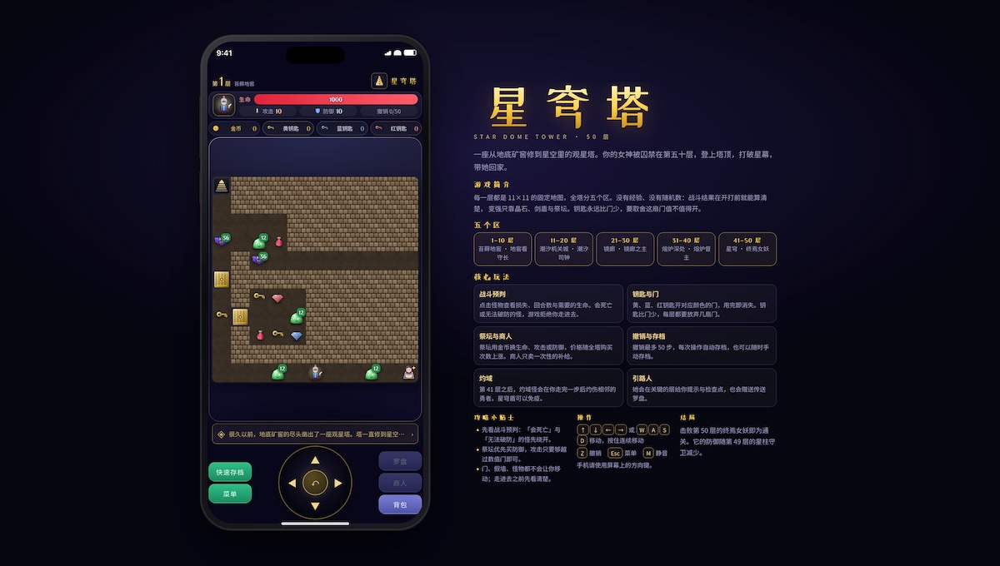

# Star Dome Tower

[简体中文](README.md)

> 💰 Cost: CNY 100 ｜ ⏱️ Time: 3+ hours (working until 3 a.m.)

> An original adventure through a 50-floor observatory that rises from the mines into the stars.

> 🤖 This project was developed with AI.



Star Dome Tower is a Magic Tower–style RPG available as a Vue 3 + Vite web game, an Electron desktop app, and a Flutter native app. The Banshee of Ruin has imprisoned your beloved goddess at the summit. Climb all 50 floors, break the Star Veil, and bring her home.

## 60-Second Trailer

From the underground mines to the starry summit, tour all five regions in one minute. Gameplay footage shows combat previews, choices about spending keys, items, and undo as the hero climbs 50 floors to rescue the goddess.

https://github.com/user-attachments/assets/ee59ad69-22ea-4ac1-bb5e-8aaae13b1f35

[Download Original (MP4 · 16:9 · 1920 × 1080)](project/video/cl/星穹塔-主宣传片-60s-16x9.mp4)

## Flutter v1.0.5 Downloads

See the [v1.0.5 release](https://github.com/lnys/starTower/releases/tag/v1.0.5) for Windows x64 installer and portable builds, macOS Universal DMG and ZIP, the Android test APK, and the iOS simulator ZIP. The iOS package does not run on physical iPhones; the Android APK is test-signed.

## Older Desktop Downloads (Flutter v1.0.2)

| Platform | Installer | Portable |
| --- | --- | --- |
| Mac (Intel / Apple silicon) | [DMG Installer](https://github.com/lnys/starTower/releases/download/v1.0.2/StarDomeTower-Flutter-1.0.2-mac-universal.dmg) | [ZIP](https://github.com/lnys/starTower/releases/download/v1.0.2/StarDomeTower-Flutter-1.0.2-mac-universal.zip) |
| Windows (x64) | [EXE Installer](https://github.com/lnys/starTower/releases/download/v1.0.2/StarDomeTower-Flutter-1.0.2-windows-x64-setup.exe) | [Portable ZIP](https://github.com/lnys/starTower/releases/download/v1.0.2/StarDomeTower-Flutter-1.0.2-windows-x64-portable.zip) |

On Mac, open the DMG and drag Star Dome Tower to Applications. On Windows, run the installer or extract the entire portable ZIP and launch `star_tower.exe`. The game can be played offline.

[Setup Guide](https://github.com/lnys/starTower/releases/download/v1.0.2/INSTALL.md) · [Checksums](https://github.com/lnys/starTower/releases/download/v1.0.2/SHA256SUMS.txt) · [Release Notes](https://github.com/lnys/starTower/releases/tag/v1.0.2)

### Electron Downloads (v0.1.0)

| Platform | Installer | Portable |
| --- | --- | --- |
| Mac (Intel / Apple silicon) | [DMG Installer](https://github.com/lnys/starTower/releases/download/v0.1.0/StarDomeTower-0.1.0-mac-universal.dmg) | [ZIP](https://github.com/lnys/starTower/releases/download/v0.1.0/StarDomeTower-0.1.0-mac-universal.zip) |
| Windows (x64) | [EXE Installer](https://github.com/lnys/starTower/releases/download/v0.1.0/StarDomeTower-0.1.0-windows-x64-setup.exe) | [Portable EXE](https://github.com/lnys/starTower/releases/download/v0.1.0/StarDomeTower-0.1.0-windows-x64-portable.exe) |

[Mac Setup](https://github.com/lnys/starTower/releases/download/v0.1.0/Mac-Install.md) · [Windows Setup](https://github.com/lnys/starTower/releases/download/v0.1.0/Windows-Install.md) · [Checksums](https://github.com/lnys/starTower/releases/download/v0.1.0/SHA256SUMS.txt) · [Release Notes](https://github.com/lnys/starTower/releases/tag/v0.1.0)

## Features

- **Deterministic combat, no XP.** Each floor is a fixed 11×11 map. You can calculate a fight’s outcome before it starts.

- **Combat preview.** The card shows expected HP loss, rounds, and required HP. The game stops you from entering fights you cannot survive or deal damage in.

- **Limited resources.** There are fewer keys than doors, and resources do not respawn. Choose which doors to open, which monsters to fight, and when to come back.

- **Altars and merchants.** Spend gold on HP, attack, or defense. Altar prices rise with each purchase across the tower, and merchant supplies are one-time purchases.

- **Undo and saves.** Undo up to 50 steps; autosave is available alongside manual saves.

- **Touch controls.** Use the on-screen D-pad on mobile. The Vue desktop layout frames the game like a phone.

## Five Regions

| Floors | Region |
| --- | --- |
| 1–10 | Moss Cellar · Cellar Warden |
| 11–20 | Tideworks · Tide Bellkeeper |
| 21–30 | Mirror Gallery · Lord of the Mirror Gallery |
| 31–40 | Forge Depths · Forge Overlord |
| 41–50 | Star Dome · Banshee of Ruin |

From floor 41 onward, some monsters burn adjacent heroes after each step. The Star Dome Shield blocks the burn. Defeat the Banshee of Ruin on floor 50 to clear the game.

## Controls

| Action | Keyboard | Touch |
| --- | --- | --- |
| Move | `↑ ↓ ← →` or `W A S D` | On-screen D-pad |
| Undo | `Z` | D-pad center |
| Menu | `Esc` | Menu button |
| Mute | `M` | — |

## Quick Start

Requirements: Node.js with ESM support and npm.

```bash
cd project
npm install
npm run dev      # Start the Vite dev server
```

Build the standalone HTML page:

```bash
npm run build    # Output: dist/index.html
```

Run tests and validate all floors:

```bash
npm test
```

`npm test` runs 28 engine tests, 17 rules tests, full map validation, the 3,779-step playthrough in the real engine, and five UI regression tests.

## Language

Open **Settings → Language** from the title screen or in-game to switch between **简体中文 / English / 日本語**. Simplified Chinese is the default. The change takes effect immediately, is saved locally, and leaves game saves untouched. Vue and Flutter share a translation table; see the [project README](project/README.en.md#language).

## Flutter Native

The [Flutter source](project/flutter/README.md) contains the game screen without the website introduction or phone frame. It includes Windows, macOS, iOS, and Android projects; see the Flutter README for mobile builds and signing status. Installers are on [GitHub Releases](https://github.com/lnys/starTower/releases).

```bash
cd project/flutter
flutter pub get --enforce-lockfile
flutter test
flutter run -d macos
```

## Project Layout

```
project/
├── src/
│   ├── App.vue              Main UI
│   ├── components/          Title screen, board, dialogs, story, and ending
│   ├── engine/              Browser audio, art, and saves
│   └── game/star/
│       ├── engine.js        Pure JS game engine, independent of Vue
│       ├── rules.js         Shared combat formulas
│       ├── data.js          Monsters, items, and merchants
│       └── maps/            Maps for all 50 floors
├── images/                  SVG artwork
├── scripts/generate-images.js  Art generator
├── tests/                   Engine, rules, and full playthrough tests
├── tools/                   Tower and map validation tools
├── docs/star-map-brief.md   Map authoring guide
└── 魔塔50层新玩法.md        Gameplay specification: rules and balance
```

For rules and balance, refer to `魔塔50层新玩法.md`. The engine is pure JavaScript. Both combat previews and actual combat call the same `rules.js`, so their results agree.

## Modding and Development

- **Monsters and items:** edit `src/game/star/data.js` and update the art mapping in `src/engine/star-art.js`.

- **Maps:** edit `src/game/star/maps/*.js`, run `node tools/star-verify.mjs` for the full tower, and run `node tools/star-check.mjs <file>` to check dimensions, symbols, and connectivity in a map chunk.

- **Rules:** update `src/game/star/rules.js` and its checks in `tests/star-rules.mjs`.

- Run `npm test && npm run build` after game changes.

- In a workspace containing both the game project and `skills/`, run `python3 skills/sync-project.py <changed-files...>` after each change to update the source snapshot and checksums. Then run `bash skills/verify.sh`.

## Changelog

### v1.0.5 — 2026-11-19

- Aligned the logo, title, expandable one-line hints, combat, and shop interactions across iOS, Android, Vue Web, and Flutter Web to leave more room for the board.

- Raised music and effects volume while preserving saved settings. Added five new themes that can be switched and saved immediately.

- Added a home icon to the return-to-title button and theme-aware animated stars to the New Adventure screen, with reduced-motion support.

- Added Simplified Chinese, English, and Japanese switching from the title screen and in-game. Removed Vue’s download QR promo but kept touch controls.

- Synced the Skill source, assets, and 60-second trailer. See the [changelog](project/游戏更新说明.md). See Flutter v1.0.5 downloads above.

### v1.0.4 — 2026-11-18

- The guide can replay earlier dialogue. First-time rewards such as the compass are still granted only once, and older saves can be loaded.

- Added separate SVG icons for nine special items, including the pickaxe, Frost Core, and compass, shared by Vue and Flutter.

- Corrected yellow doors on floor 11 and supplies on floors 39 and 48, and restored a cracked wall on floor 41. Vue and Flutter passed the 3,779-step clear replay with 1,241 HP, 378 attack, and 501 defense.

- Fixed the WeChat QR image URL and added more whitespace around the then-present game QR code. Narrow layouts, audio startup, and muting were checked in Chrome. See the [test notes](project/通关测试.md).

- This was a source update; desktop installers remained the older versions listed above.

### v1.0.3 — 2026-11-18

- Flutter Web and desktop used a fixed game window sized to one-quarter of the screen width and four-fifths of its height. NPC dialogue and trading moved below the board, away from the controls.

- Redesigned floor 50 as a starlit garden with a moonlit cabin holding the goddess, four fightable guards, flower beds, a crystal fountain, lanterns, and a long carpet.

- Redesigned the giant Banshee of Ruin with horns, torn wings, fangs, and crimson rifts. Defeating her unlocks a rescue ending with starlight, illustrations, a letter, and a commemorative title.

- Added guide, altar, and monster icons, and fixed quick-save label wrapping in both Vue and Flutter.

- Completed saves can replay the ending. Older final-floor saves retain hero stats, boss defeat, and completion status during migration.

- Vue passed 28 engine tests, 17 rules tests, map validation, and the build. Flutter passed 18 tests and static analysis. The 3,774-step replay result was unchanged.

- Updated the snapshot, gameplay docs, and test records. See the [changelog](project/游戏更新说明.md). This update shipped source and Skill changes, not new installers.

### v1.0.2 — 2026-11-18

- Added the Flutter game source under `project/flutter/`, with all 50 floors, offline assets, music, and local saves, without the website introduction or phone frame.

- The Dart engine matched Vue’s 3,774-step clear: 791 HP, 378 attack, and 501 defense. Eight engine and multi-size UI tests passed.

- Added GitHub Actions packaging for Flutter Mac Universal DMG / ZIP and Windows x64 installer / portable ZIP. Publication follows successful builds for both platforms and includes checksums and setup instructions.

- `verify.sh` checks both Vue and Flutter source. `rebuild.sh` restores the full project and verifies Vue; use the Flutter commands above to test Flutter separately.

- Launch was checked on an Intel Mac and in the iPhone simulator. Both platform builds, Mac package integrity, and the automated Windows install, launch, and uninstall checks passed. Apple silicon and physical mobile devices were not tested. See [v1.0.2 downloads](https://github.com/lnys/starTower/releases/tag/v1.0.2).

### v1.0.1 — 2026-11-17

- Added the reusable `$star-tower` Skill, entered via [SKILL.md](SKILL.md). This directory contains the original `project/` source snapshot, `MANIFEST.sha256`, `verify.sh`, and `rebuild.sh`, without build outputs or dependency caches.

- The restored project can build the web game, a Mac Universal desktop app, and Windows x64 installer and portable builds.

- `rebuild.sh` only writes to an empty directory and runs the locked dependency install, playthrough replay, and web build.

- See the [test notes](project/通关测试.md) and [desktop packaging guide](project/docs/桌面版打包.md). Intel Mac launch, Mac package integrity, and Windows installer structure were checked; Apple silicon and physical Windows machines were not tested.

```bash
bash verify.sh
bash rebuild.sh /path/to/empty/star-tower
cd /path/to/empty/star-tower
npm run dist:mac
npm run dist:win
```

### v1.0.0 — 2026-11-13 Initial Release

- First release: 50 floors, five regions, and five regional bosses.

- Complete fixed maps with checks for stair chains, entrances, mechanism doors, and related map constraints.

- Combat previews show expected damage, rounds, and required HP when next to a monster.

- Altars, merchants, up to 50 undo steps, and automatic and manual saves.

- On-screen D-pad for mobile and a phone-frame preview on desktop.

## Updates and Feedback

Suggestions on gameplay, balance, maps, UI, and art are welcome in [Issues](https://github.com/lnys/starTower/issues).

Issues and pull requests are welcome, especially for map balance, desktop compatibility, and art.

## Credits

The maps, balance, and story text are original.

Thanks to the classic **Magic Tower** for inspiring the core loop: climb floor by floor, making tradeoffs with scarce resources. Star Dome Tower does not copy its maps, names, or dialogue.

## Join the WeChat Group

Scan the code to join the WeChat group, share strategies, report problems, and chat about Star Dome Tower.


## License

This project is released under the [MIT License](LICENSE).
